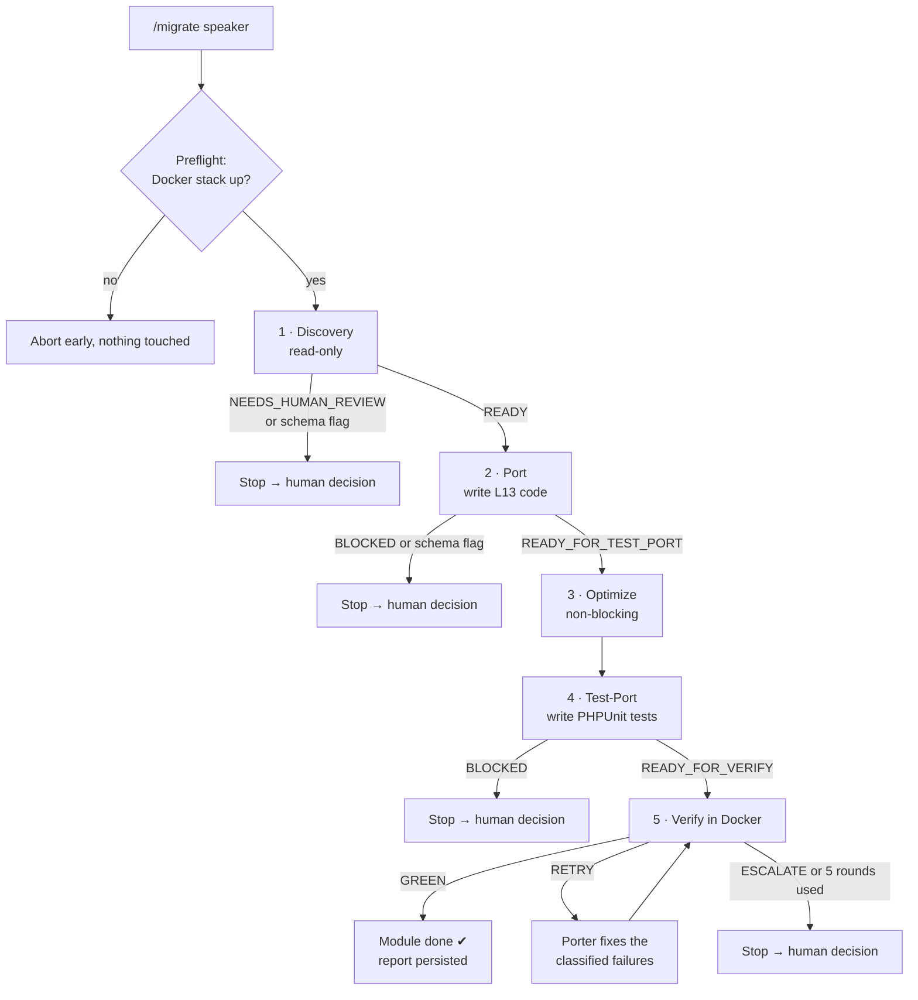

# AI Agent–Driven Migration: How It Was Prepared and How It Works

> How a team of Claude Code agents was set up to port application modules from **Laravel 6 (PHP 7.2)** to **Laravel 13 (PHP 8.3)**, and how the agents run day to day.

---

## 1. Context

VenuIQ is a large Laravel 6 conference/event platform: hundreds of controllers, roughly 500 migrations, MySQL + MongoDB, a web admin and several mobile/partner API versions. Instead of upgrading one Laravel version at a time, the app is rebuilt in a new Laravel 13 repository **module by module**, porting directly from the L6 source.

That's the only project detail you need here. The rest of this document is about the **AI agent system** doing the porting.

---

## 2. Core idea

> **Humans decide, agents execute, and gates sit between every stage.**

The agents don't improvise architecture. Every important decision (auth approach, folder layout, which API versions survive, database policy) was made and written down **before** any agent wrote code. The agents' job is to apply those decisions faithfully and consistently across many modules, and to **stop and ask** when something is outside them.

Three principles shaped the setup:

1. **Port, don't refactor.** Agents translate behaviour 1:1. If they spot a legacy bug, they port it faithfully and *flag* it rather than silently fixing it.
2. **Specialised agents with narrow permissions.** Each agent does one job and has only the tools that job needs. For example, the discovery agent and the verifier cannot edit files.
3. **Machine-checkable hand-offs.** Each stage returns a structured verdict (`READY`, `BLOCKED`, `GREEN`, …), and the pipeline branches on that field only, never on free-text prose.

---

## 3. Preparation: what had to exist before the agents could work

### 3.1 A migration knowledge base (the agents' "spec")

A separate **docs repository** is the single source of truth. Agents read it before every task:

| Document type | Purpose for the agent |
|---|---|
| **Audit docs** (`00_audit`, `01_package_audit`, `04_php_upgrade`) | Inventory of the codebase, every package's upgrade/replace/drop path, every PHP 7.2→8.3 breaking pattern found by scanning the real code |
| **Locked architecture decisions** (`02_architecture_decisions`) | Decisions the agent must apply and **never re-debate**, e.g. "keep custom JWT", "all models live in `app/Models`" |
| **One doc per module** (`modules/*.md`, 70+) | Files affected, routes, breaking changes, action items, and a **Test Cases table**. This is the agent's task list. |
| **Architecture notes** (`architecture/*.md`) | Target folder layout, DB config, Docker, queues |

Writing these docs first is what lets the agents be **consistent across many modules** and many sessions.

### 3.2 Agent definitions (`.claude/agents/*.md`)

Each agent is a Markdown file with a frontmatter header (name, description, **allowed tools**) and a detailed instruction body: responsibilities, hard rules, and a required output format.

| Agent | Role | Can write code? |
|---|---|---|
| `module-discovery` | Checks the module doc against the real L6 source: finds missing files and the full migration history of every table the module owns, and raises schema mismatches | ❌ Read-only |
| `module-porter` | Writes the Laravel 13 code for the module into the target repo | ✅ |
| `code_optimization_agent` | Applies behaviour-preserving improvements (security, N+1 queries, dead code) and logs each one | ✅ (non-functional only) |
| `test-porter` | Writes PHPUnit 12 tests from three inputs: the module doc's test table, legacy tests, and QA test-case spreadsheets | ✅ (tests/factories only) |
| `verifier` | Runs the module's tests and the full regression suite in Docker, then classifies each failure | ❌ Read-only |

### 3.3 A workflow script and a one-word command

- **`.claude/workflows/migration.js`** chains the agents, enforces the gates and runs the fix-retry loop.
- **`/migrate <module> [module…]`** is the only command an engineer types to start a full migration.

### 3.4 Per-machine and per-project scaffolding

| File | Why it exists |
|---|---|
| `.claude/repo-paths.local.json` | Each developer's absolute paths to the **source**, **target** and **docs** repos. Agents resolve paths from here, so nothing is hard-coded per machine. |
| `CLAUDE.md` (target repo) | A long-lived project memory: commands, architecture, and a running log of what each module's port found. Every new agent session starts with this context. |
| `.claude/discovered-credentials.local.md` (gitignored) | Where agents record hard-coded secrets they moved into `.env`, so the real values reach whoever configures production |
| `optimization.md` | Audit log of every optimisation applied or deliberately deferred |
| `storage/app/migration-reports/<module>.md` | A durable per-module report of the full run, kept even when a run is blocked |

---

## 4. How the pipeline works



### Stage by stage

1. **Preflight.** The pipeline confirms the Docker test stack is running *before* any work, so a run doesn't spend time on discovery and porting only to fail at verification.
2. **Discovery** (read-only). The agent checks every file the module doc lists and actively searches for files the doc *missed* (commands, jobs, listeners, form requests…). Module docs regularly under-list these. It also rebuilds the **complete migration history** of each owned table and compares it with the target. Any schema difference is a **hard stop** that needs human approval.
3. **Port.** The porter translates each file from L6 to L13, applying the locked decisions and only the *required* PHP 8.3 / Laravel 13 compatibility fixes. It also:
   - re-resolves every class import against the agreed target location (never copies a legacy namespace blindly);
   - replaces placeholder ("stub") routes with the real ones, so no route name ends up defined twice;
   - checks that the module's menu entry exists, so a ported screen is actually reachable;
   - checks every delete path and adds any missing cleanup (child rows, pivot rows, files, cache). This is the one sanctioned exception to "don't change logic";
   - moves hard-coded secrets into `.env` config.
4. **Optimize.** A separate agent makes safe, behaviour-preserving improvements and logs each one. Anything risky (indexes, infrastructure changes) is documented but not applied. This stage never blocks the pipeline.
5. **Test-Port.** Tests are written from three independent sources, and **every** row of the module's test table and any matching QA spreadsheet must be covered. Every permission-gated route needs at least one real HTTP test that asserts a success response.
6. **Verify** (read-only). Runs the tests in Docker, then sorts each failure into one category (`mechanical-pattern-missed`, `logic-mismatch`, `config-gap`, `storage-engine-mismatch`, `coverage-gap`, `hardcoded-credential`). A `RETRY` sends the classified failures back to the porter. After **5 rounds** the pipeline escalates to a human instead of looping.

Modules run **sequentially** in one working tree, so the porter, test-porter and verifier for a module always see each other's files, and two modules never write into the same checkout at the same time.

---

## 5. Guardrails built into the agents

These rules are written into the agent instructions as absolute "NEVER/ALWAYS" statements:

| Guardrail | Why |
|---|---|
| **Never touch `database/migrations/` or `database/seeders/`** | Production reuses the existing live database. Migrations are tracked by filename, so a renamed or new file could run against production and lose data. |
| **Schema differences → flag and stop** | Only a human can approve a new forward migration |
| **Never change business logic** | Behaviour parity with legacy is the acceptance bar. Bugs are flagged, not fixed in passing. |
| **No modernisation beyond what's needed** | No new PHP 8.1+ idioms (enums, readonly, `match`) retrofitted into ported code; it's a compatibility port, not a rewrite |
| **Source repository is read-only** | All writes go to the target or docs repo |
| **Escalate judgement calls** | Undocumented integrations, ambiguous ownership and open architecture questions go to a human instead of being guessed |
| **No secrets in commits** | Credentials are moved to `env()` config and recorded privately |

---

## 6. Lessons that became rules

The agent instructions are **living documents**. When a real incident happened, the root cause was written back into the relevant agent's rules so it couldn't recur. Examples:

| Incident | Rule added |
|---|---|
| A module passed verification at the model layer while **every authenticated route returned 403** for real users | Test-porter must write a success-path HTTP test for every gated route group, and the verifier refuses `GREEN` without one |
| Ported classes imported a stale namespace that "compiled" but silently dropped date-casting behaviour | Porter must check every import against the agreed target location, not against whatever happens to exist |
| A leftover placeholder route silently shadowed a real route with the same name | Porter edits the stub in place, and the verifier checks for duplicate route names |
| A git merge silently deleted migration and seeder files | Verifier checks migration/seeder file-count parity with the source before reporting `GREEN` |
| Early pipeline versions searched agent prose for words like "GREEN", which misread phrases such as "not GREEN yet" | All stages return schema-validated JSON, and control flow uses the enum field only |
| Hard-coded third-party credentials were found in legacy code | Porter moves them to config, and the verifier runs a 3-step secret scan (keyword grep, known vendor key formats, manual diff review) |

---

## 7. Working with the agents beyond the pipeline

The full `/migrate` pipeline handles whole modules. Day-to-day bug fixing and QA follow-up use the same knowledge base in **interactive sessions**, following the same discipline:

- **Compare with legacy first.** Before changing anything, the agent diffs the legacy and migrated code paths (route, middleware, validation, model methods, messages) to tell real regressions apart from documentation-only differences.
- **Prove fixes on the running app.** The agent tests changes against the local Docker stack with real requests, then adds a regression test.
- **Plans and approvals.** For larger changes, the agent presents a plan and waits for approval. For each doc or design choice, it asks one focused question instead of assuming.
- **Persistent memory.** User feedback ("review means read-only", "don't expand scope", "confirm each doc change") is saved as memory, so future sessions follow the same preferences.

---

## 8. Why this works

- **Consistency:** the same locked decisions and checks are applied to every module, in every session.
- **Safety:** hard gates around the production database, schema and secrets, and read-only roles where writing isn't needed.
- **Traceability:** every run leaves a report, every optimisation is logged, and every deviation is flagged.
- **Humans stay in control:** agents stop at the decisions that really need a person (schema changes, business-logic questions, open architecture choices) and handle the repetitive translation work at scale.

---

## 9. Sample prompts: porting a module through all stages

This is the prompt used to port a module through every stage. Replace `<module>` with the module doc's name (e.g. `mentor`):

```text
Migration doc: <module>.md
Target repo: venuiq-platform
Run the Claude agents in this series:
module discovery -> module porter -> code optimization -> test porter -> verifier.
Start with module discovery and proceed further. Once a stage is done, stop and
wait for my confirmation before moving to the next one.
```

After reviewing each stage's report, reply `proceed to next stage` to continue, or `resume the migration` after a session break.

---

### Quick reference

| Want to… | Do this |
|---|---|
| Migrate a module end to end | `/migrate <module_name>` |
| Migrate several modules in sequence | `/migrate speaker sponsor workplace` |
| Read what an agent is allowed to do | `.claude/agents/<agent>.md` |
| See the pipeline logic | `.claude/workflows/migration.js` |
| See the result of a run | `storage/app/migration-reports/<module>.md` |
| Check a locked decision | `02_architecture_decisions.md` (docs repo) |
